# Daybloom

[](https://github.com/Yabsera-Haile/daybloom/actions/workflows/ci.yml)

**A calm personal planner that feels like paper and remembers like a calendar.** Daybloom keeps your day, your habits and your spending in one gentle place. It's for people who want the simplicity of a paper planner with the scheduling ease of Google Calendar, without accounts, ads or clutter.

- **Android** today (phones, tablets and foldables); iOS is planned.
- **Private by design:** everything stays on the phone. There's no account and no server.
- Built with Expo (React Native), TypeScript, NativeWind and SQLite.

## Screenshots

<table>
  <tr>
    <td align="center">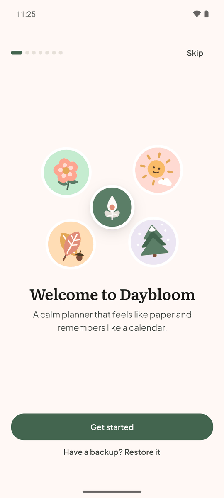<br/><sub>Welcome</sub></td>
    <td align="center">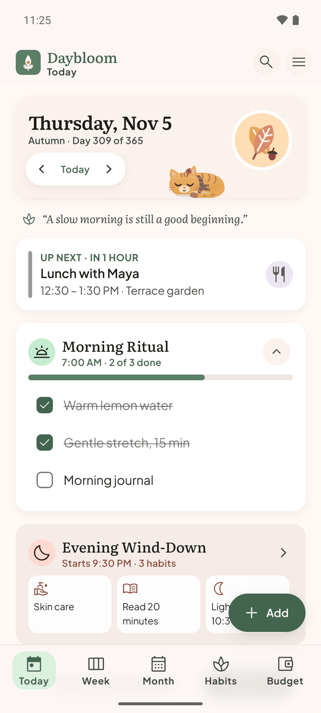<br/><sub>Today</sub></td>
    <td align="center">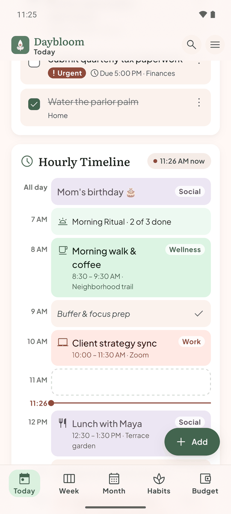<br/><sub>Hourly timeline</sub></td>
    <td align="center">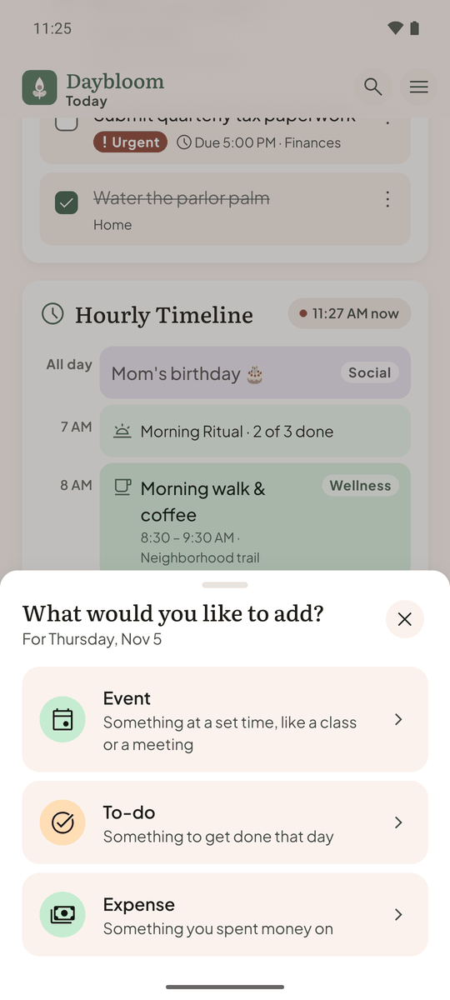<br/><sub>+ Add</sub></td>
  </tr>
  <tr>
    <td align="center">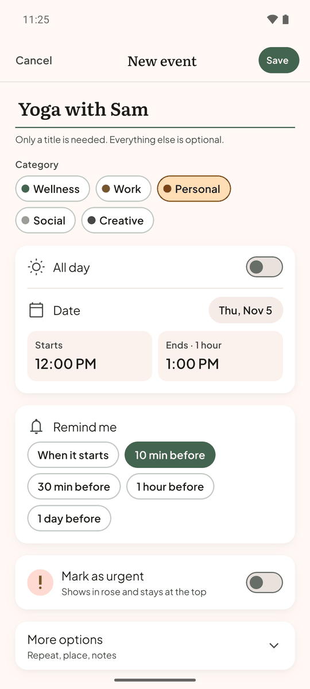<br/><sub>New event</sub></td>
    <td align="center">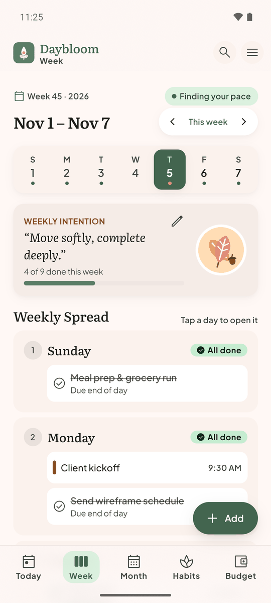<br/><sub>Week</sub></td>
    <td align="center">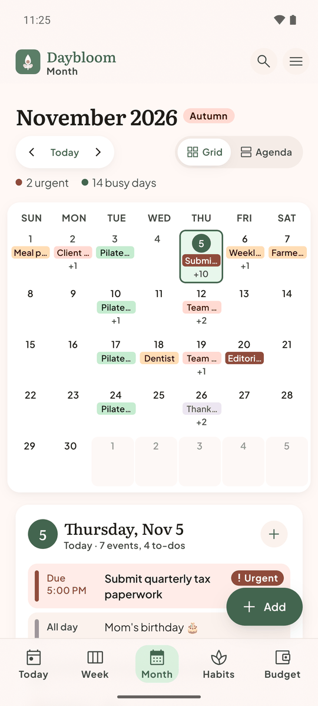<br/><sub>Month</sub></td>
    <td align="center">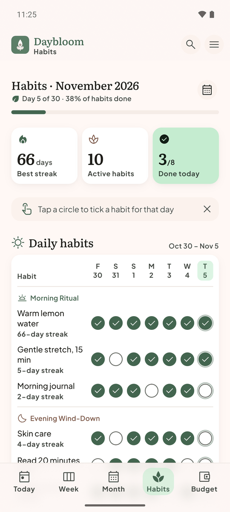<br/><sub>Habits</sub></td>
  </tr>
  <tr>
    <td align="center">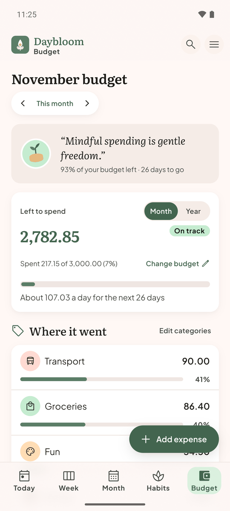<br/><sub>Budget</sub></td>
    <td align="center">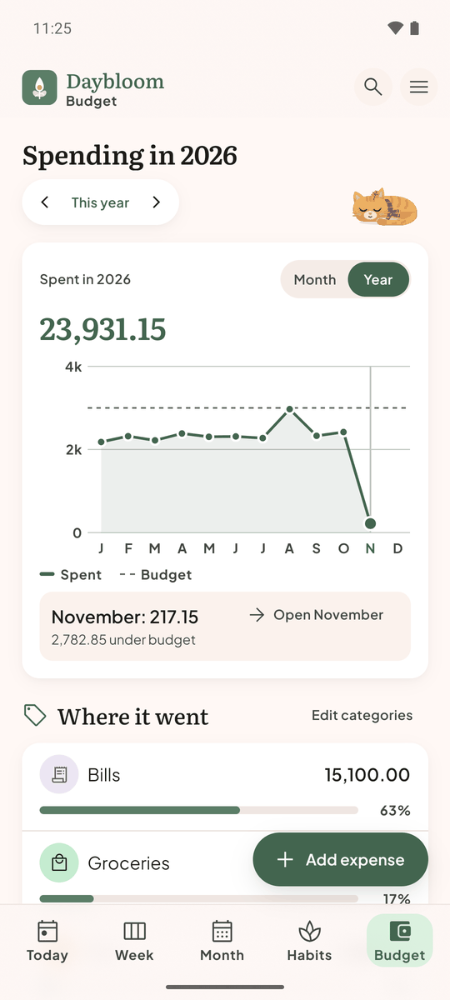<br/><sub>The year at a glance</sub></td>
    <td align="center">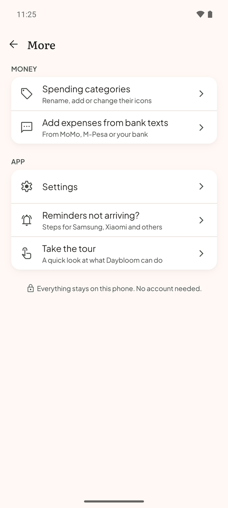<br/><sub>More (≡)</sub></td>
    <td align="center">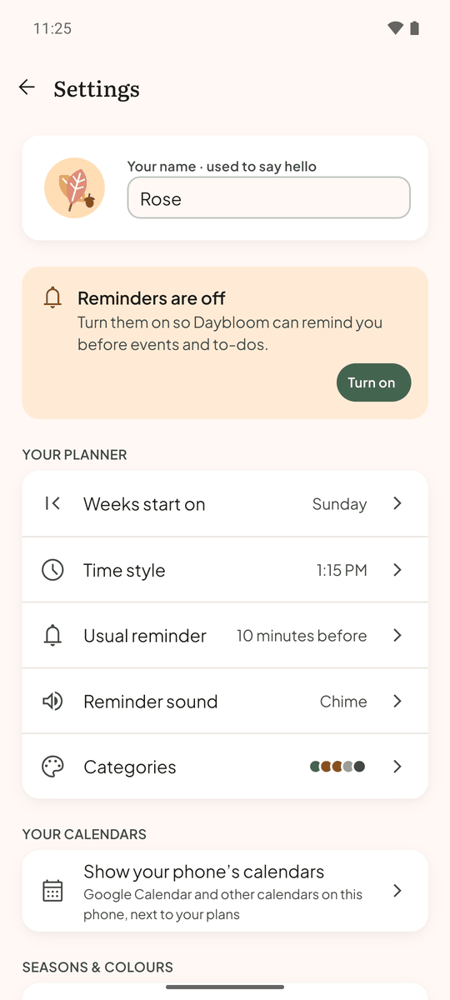<br/><sub>Settings</sub></td>
  </tr>
</table>

<sub>Screenshots are from the Android emulator with made-up sample data.</sub>

## What it does

| | |
|---|---|
| **Today** | A planner page for the day: to-dos ("Daily Intentions"), an hourly timeline of events and notes, your morning and evening routines, what's up next, and a daily quote |
| **Week and Month** | The week as a spread with up to three weekly priorities, and the month as a grid or an agenda, with one goal for the month |
| **Events** | Repeats ("Every Tuesday"), reminders, categories, an urgent flag, places and notes. Change one occurrence or the whole series |
| **Habits and routines** | Daily and weekly habits, grouped into routines like a Morning Ritual. Tick them off and watch your streaks grow |
| **Budget** | A monthly or weekly budget, spending by category, savings goals, bills, and a year of spending as a chart |
| **Bank texts** (Android) | Payments from MoMo, M-Pesa or bank texts can be added to your budget for you |
| **Your phone's calendars** | Show Google Calendar (and any calendar on the phone) next to your plans, add events to it, and answer invitations |
| **A companion** | A cat, dog or dragon naps on your pages, dresses for the season, cheers when you get things done and grumbles a little when things slip |
| **Make it yours** | Four seasonal colour themes, reminder sounds, calm mode, large-text and screen-reader support |

## Using Daybloom

**Getting started.** The first time you open Daybloom, a few short pages ask for your name (optional), pick a companion and explain each permission before your phone asks. A quick tour then shows where everything is. You can retake it any time from **≡ › Take the tour**. If you're moving from another phone, tap **Have a backup? Restore it** on the welcome page.

**Moving around.** The tabs at the bottom are **Today, Week, Month, Habits and Budget**. The 🔍 in the header searches your plans, habits and spending. The **≡** opens More: spending categories, bank texts, Settings and help.

**Adding things.** Tap **+ Add** on any planner page and choose an **Event**, a **To-do** or an **Expense**. It's added to the day you're looking at. Only a title is needed; everything else is optional.
- On **Today**, swipe left or right to change the day, tap an empty hour to plan something in it, and tap a to-do's box to tick it.
- Tap an event to see it, change it, copy it or delete it. Deleting can be undone for a few seconds.

**Week and Month.** Week shows each day as a card. Tap a day to open it, write an intention for the week, and keep up to three weekly priorities. Month switches between a **Grid** and an **Agenda**. Tap a day to see its plans, and set one goal for the month to work towards.

**Habits.** Tap **New habit** and choose how often (every day or once a week) and when (in a routine like your Morning Ritual or Evening Wind-Down, or Anytime). Tick a habit on Today or tap any circle on the Habits page. Reminders can follow the routine's time, or repeat through the day (handy for drinking water). The calendar button shows a habit's whole month.

**Budget.**
- **Budget plan:** tap **Change budget** to set a monthly or weekly amount, then **Add expense** as you spend.
- **Where it went:** your spending by category. Tap a category to see its expenses.
- **Year view:** the **Month / Year** switch shows a whole year as a chart.
- **Savings goals:** put money aside a little at a time.
- **Bills:** keep them here so they're counted in your spending when they're paid.

**Expenses from bank texts (Android).** Under **≡ › Add expenses from bank texts**, pick who texts you about payments, check what Daybloom understood, and choose which of this month's payments to add. After that, each new payment is added as it arrives, and Daybloom can ask "What was it for?" so it lands in the right category. It reads only the senders you pick, and only on your phone.

**Your calendars.** In **Settings › Show your phone's calendars**, pick the calendars to show (for example your Google Calendar). New events can go to that calendar too, and invitations can be answered with Yes, Maybe or No. Your phone keeps them in sync with Google; Daybloom never signs in anywhere.

**Settings.** Week start, 12- or 24-hour time, your usual reminder, reminder sound, event categories, colours (a season, or "Follow the seasons"), your companion's kind, name and personality, currency and calm mode. **Reminders not arriving?** walks through the phone's battery settings, brand by brand.

**Your data.** Everything is stored on the phone. **Settings › Back up your data** saves a file you can keep anywhere, and **Restore from a backup** brings it back on this or a new phone. A restore shows what's in the file before replacing anything, and can be undone.

## Run it on your computer

You need:
- **Node.js 22.13 or newer.** Node 24 LTS is recommended: `winget install OpenJS.NodeJS.LTS` on Windows, or download it from [nodejs.org](https://nodejs.org).
- An **Android phone** with the [Expo Go](https://play.google.com/store/apps/details?id=host.exp.exponent) app, or an **Android emulator** from Android Studio.

```bash
git clone https://github.com/Yabsera-Haile/daybloom.git
cd daybloom
npm install        # also applies the small patch in patches/ (patch-package)
npm start          # starts the dev server and shows a QR code
```

- **On a phone:** open Expo Go and scan the QR code. The phone and the computer need to be on the same Wi-Fi; if they can't reach each other, use `npx expo start --tunnel`.
- **On an emulator:** start it from Android Studio's Device Manager, then press `a` in the terminal (or run `npm run android`).

**What Expo Go can't do.** Expo Go is the quickest way to try Daybloom, but three things need the installed app (next section):
- reminders don't ring in Expo Go on Android;
- bank texts and the phone's calendars use Daybloom's own native modules, which Expo Go doesn't have. These screens say "works in the installed app".

In development builds, **≡ › Component gallery** shows every building block side by side, to compare with the designs in `design/daybloom/`.

## Install it on a phone

### Build it yourself (no account needed)

```bash
npx expo prebuild --platform android --clean   # makes the android/ folder (not kept in Git); undo its package.json change afterwards
cd android
./gradlew assembleRelease -PreactNativeArchitectures=arm64-v8a   # a phone (Windows: gradlew.bat)
# or -PreactNativeArchitectures=x86_64 for the emulator
# → android/app/build/outputs/apk/release/app-release.apk
```

Install it with `adb install -r android/app/build/outputs/apk/release/app-release.apk`, with the phone connected over USB and USB debugging on. Because Daybloom can read payment texts, Play Protect blocks installing this APK from a browser or file manager, so use `adb`.

**On Windows:**
- The native build fails ("build.ninja still dirty") when the project's path contains spaces. Build from a copy at a path without spaces, e.g. `robocopy "<project folder>" C:\dev\daybloom-build /MIR /XD .git`, then run Gradle in `C:\dev\daybloom-build\android`. A mapped drive (`subst`) or a junction doesn't help.
- Robocopy's `/XD build` option also skips every package's `build` folder, so leave it out.

### Build it in the cloud (EAS)

Needs a free Expo account:

```bash
npx eas-cli@latest build --platform android --profile preview      # an installable test APK
npx eas-cli@latest build --platform android --profile production   # a Play Store bundle
```

The Android package name is `com.daybloom.app` (in `app.json`). It can't change after the first Play Store upload.

## Project structure

```
daybloom/
├── src/
│   ├── app/            Screens. Expo Router: every file is a route
│   │   ├── (tabs)/     Today (index), Week, Month, Habits, Budget, and the tab bar
│   │   ├── event/ habit/ bill/                    add and edit forms
│   │   ├── bank-texts/                            setting up expenses from bank texts
│   │   └── onboarding, settings, search, more, savings, bills, spending, …
│   ├── features/       The pieces screens are made of: Today's parts, sheets, forms, the tour, the pet,
│   │                   budget cards, bank-text and settings sections
│   ├── ui/             Shared components (Text, Button, chips, checkboxes, cards, tab bar, sheets),
│   │                   plus icons and stickers generated from the designs (ui/generated)
│   ├── theme/          Typed design tokens, the four seasonal colour themes, fonts, shadows
│   ├── db/             SQLite schema (Drizzle), the database client, an in-memory test database
│   ├── data/           Reading the database into screens (useLive) and keeping unsaved drafts
│   ├── state/          Which sheet or Undo bar is showing (zustand)
│   ├── planner/        Events and repeats, to-dos, hour notes, categories, the month's goal, quotes, search
│   ├── recurrence/     Repeat rules (RFC 5545, the format Google Calendar uses) and their plain-words labels
│   ├── habits/         Routines, habits, ticks and streaks
│   ├── budget/         Budgets, expenses, spending categories, savings goals, bills, the year chart
│   ├── reminders/      Which reminders to schedule, sounds, keeping the phone's notifications in step
│   ├── sms/            Bank texts: learning a sender's formats, reading payments, adding them
│   ├── calendarSync/   Two-way sync with the phone's calendars (and a fake calendar store for tests)
│   ├── pet/            The companion's mood and its reminders
│   ├── backup/         Backing up to a file and restoring from one
│   ├── calendar/       Date maths: weeks, day of year, seasons by hemisphere, time zones
│   ├── settings/       Settings and their phone-based defaults
│   ├── i18n/           Every word on screen (English) and date, time and money formatting
│   └── __tests__/      Screen tests: the real screens on an in-memory database
├── modules/            Daybloom's own native Android modules (Kotlin): daybloom-sms, daybloom-calendar
├── plugins/            Expo config plugins (keeps the reminder sounds in release builds)
├── patches/            A small patch to expo-notifications (the pet's picture on reminders)
├── drizzle/            Database migrations, generated from src/db/schema.ts
├── assets/             App icon, splash and reminder sounds
├── e2e/                End-to-end flows for Maestro, run on the installed app
├── design/
│   ├── daybloom/       The designs: a clickable HTML prototype with screenshots of every screen
│   ├── tokens.json     Colours, type and spacing: the single source of truth for the theme
│   ├── themes.json     The seasonal colour themes (generated)
│   └── stitch/         The original Google Stitch export, kept for reference
├── docs/               Plan, requirements, test plan, design review, and these screenshots
├── scripts/            Generators: icons and stickers, app icons, themes, reminder sounds; pet and theme previews
└── .github/workflows/  CI: generated files up to date, migrations match, typecheck, lint, tests, Android bundle
```

## Development

```bash
npm run check          # typecheck + lint + unit and screen tests (what CI runs)
npm test -- habits     # just the tests whose file names match "habits"
maestro test e2e/      # end-to-end flows on the installed app (see e2e/README.md)
```

- **Tests** are named after the test plan's IDs (e.g. `it('T-TD01.2 …')`), so each requirement can be traced to its test. Unit tests run against an in-memory SQLite (`createTestDb()`), as a phone in New York.
- **Colours, type and spacing:** edit `design/tokens.json`. Tailwind classes such as `bg-surface-container-low` and `p-space-md` come from it and match the class names in the HTML designs. The seasonal themes come from `npm run generate:themes`.
- **Text** always goes through `<Text variant="headlineMd">` from `@/ui` (one font file per weight), and every word on screen lives in `src/i18n/en.ts`.
- **Database:** edit `src/db/schema.ts`, then run `npm run db:generate` to create a migration. The app applies migrations on start.
- **Generated files:**
  - `npm run generate:ui`: icons and stickers, from the designs
  - `npm run generate:icons`: app icons, from the logo (needs Chrome)
  - `npm run generate:sounds`: reminder sounds

  CI fails if `src/ui/generated` is out of date.

## Documentation

| Document | What's in it |
|---|---|
| [docs/PLAN.md](docs/PLAN.md) | Product, tech stack, data model, milestones and what each version added, risks, next steps |
| [docs/REQUIREMENTS.md](docs/REQUIREMENTS.md) | What every screen must do, with IDs (TD-05, BU-11…) |
| [docs/TEST_PLAN.md](docs/TEST_PLAN.md) | How each requirement is tested |
| [docs/DESIGN_REVIEW.md](docs/DESIGN_REVIEW.md) | How the designs evolved from the first Stitch mock-ups, accessibility rules, and every design decision (D1–D28) |
| [design/daybloom/README.md](design/daybloom/README.md) | The list of designed screens and their states |
